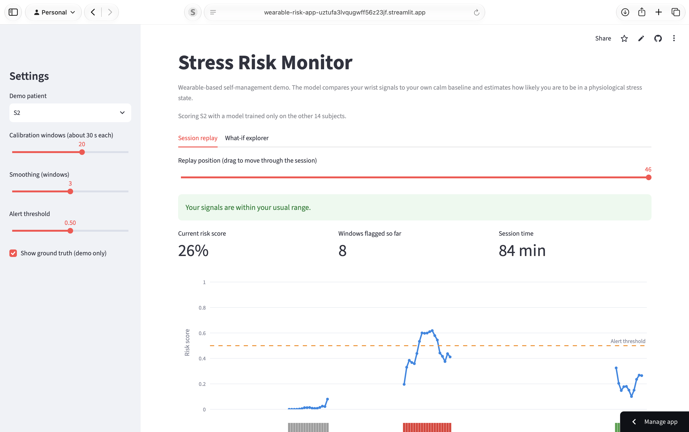

# Wearable Stress Risk Monitor

A patient-facing demo that estimates physiological stress from wrist-worn sensor data and turns it into a risk score with self-management prompts.

**Live demo:** https://wearable-risk-app-uztufa3lvqugwff56z23jf.streamlit.app/



## Problem

Chronic conditions often worsen after sustained physiological stress, and wearables can pick up changes in skin conductance and heart rate before a person notices them. This project asks: using only signals a smartwatch provides, can we flag stress states for a person the model has never seen, after a short personal calibration period?

## Data

WESAD (Schmidt et al., ICMI 2018): 15 healthy adults wearing a wrist-worn Empatica E4 (BVP, EDA, skin temperature, accelerometer) during baseline, amusement, and a Trier Social Stress Test. Used for non-commercial research with attribution.

## Method

- 60 s windows with a 30 s step, wrist signals only (what a consumer smartwatch provides)
- Binary target: stress vs. non-stress (baseline + amusement). Meditation windows and windows under 90% label purity were dropped
- 12 features: EDA (mean, std, slope, peak count, peak amplitude), skin temperature (mean, slope), accelerometer (mean, std), and PPG-derived heart rate, SDNN and RMSSD
- **Personal calibration:** each person's features are standardized against their own early baseline windows, mirroring a "wear it calmly for a few minutes" setup in a real app
- Random forest, evaluated with **leave-one-subject-out cross-validation** (train on 14 people, test on the unseen 15th)

## Results (leave-one-subject-out, mean ± std over 15 subjects)

| Features | Model | AUC | Sensitivity | Specificity |
|---|---|---|---|---|
| Raw | Logistic regression | 0.957 ± 0.049 | 0.846 ± 0.215 | 0.855 ± 0.174 |
| Raw | Random forest | 0.986 ± 0.022 | 0.836 ± 0.267 | 0.928 ± 0.118 |
| Raw, no skin temperature | Random forest | 0.972 ± 0.046 | 0.830 ± 0.266 | 0.861 ± 0.230 |
| Per-subject z-score (full session) | Logistic regression | 0.963 ± 0.060 | 0.894 ± 0.174 | 0.935 ± 0.067 |
| Baseline-calibrated | Logistic regression | 0.966 ± 0.101 | 0.867 ± 0.252 | 0.953 ± 0.062 |
| **Baseline-calibrated (final)** | **Random forest** | **0.992 ± 0.017** | **0.902 ± 0.173** | **0.963 ± 0.068** |

Ranking is strong for every held-out subject (AUC 0.94 to 1.00). The weak spots are threshold effects: at a fixed 0.5 cutoff, sensitivity was 0.45 for S3 and 0.57 for S14 even though their AUCs were 0.94 and 0.99, and specificity was 0.77 for S16 and 0.84 for S5. This suggests per-person threshold tuning would help more than a better model.

Top features: EDA level, EDA variability and EDA peak count carry most of the importance. Wrist-derived HRV contributes little, consistent with noisy PPG at the wrist.

## The app

A Streamlit dashboard: pick a demo patient, calibrate on their first baseline windows, and replay the session. The risk score is plotted against ground truth, with an alert card and a self-management prompt when risk stays above a threshold. Each patient is scored by a model trained only on the other 14 subjects. A what-if tab lets you move calibrated feature values and watch the score respond.

## Limitations

- 15 healthy adults and lab-induced stress. This is not chronic-disease data, and the results are an upper bound for real life
- "Non-stress" is baseline and amusement only. Exercise, caffeine, illness and everyday arousal are not represented
- Windows overlap by 50%, so the effective sample size is closer to the number of subjects than the number of windows
- The test subject's own baseline windows are used for calibration and are also scored as negatives, which flatters specificity slightly
- Wrist-PPG HRV was noisy and moved opposite to textbook expectations, so it contributes little
- Skin temperature may partly track time in session
- No clinical validation. **Not a medical device and not for diagnosis.**

## What a real deployment would need

Longitudinal data from people with the target condition, labels tied to clinical events, prospective validation, IRB approval, privacy and security review, and the relevant regulatory pathway.

## Run locally

```bash
python3 -m venv venv && source venv/bin/activate
pip install -r requirements-dev.txt
# download WESAD into data/WESAD, then:
python3 src/build_dataset.py
python3 src/train_model.py
python3 src/final_model.py
streamlit run app/streamlit_app.py
```

## Citation

Schmidt, P., Reiss, A., Duerichen, R., Marberger, C., Van Laerhoven, K. (2018). Introducing WESAD, a multimodal dataset for wearable stress and affect detection. ICMI 2018.